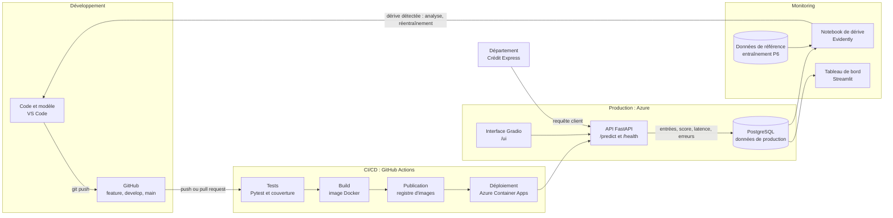

# Prêt à Dépenser : mise en production du modèle de scoring crédit

Projet 8 du parcours OpenClassrooms Data Scientist Machine Learning : *Confirmez vos compétences en MLOps (partie 2/2)*.

## Contexte

Le département Crédit Express de Prêt à Dépenser souhaite évaluer les nouvelles demandes de crédit en quasi temps réel. Ce projet met en production le modèle de scoring développé et versionné avec MLflow au Projet 6 :

- une **API** qui reçoit les données d'un client et renvoie une probabilité de défaut et une décision ;
- une **conteneurisation** avec Docker et un **pipeline CI/CD** qui teste, construit et déploie automatiquement ;
- un **monitoring** des données de production : distribution des scores, latence, erreurs et dérive des données ;
- une **analyse et une optimisation** du temps de réponse.

## Architecture MLOps



**Lecture du schéma :**

1. Chaque modification du code est poussée sur GitHub, sur une branche de travail, puis fusionnée dans `develop` et enfin dans `main`.
2. Chaque push déclenche GitHub Actions : les tests s'exécutent, puis l'image Docker est construite et publiée si les tests réussissent.
3. Une fusion sur `main` déploie automatiquement la nouvelle version sur Azure Container Apps.
4. En production, chaque appel à l'API est enregistré dans PostgreSQL : entrées, score, décision, temps de réponse et erreurs.
5. Ces données sont comparées aux données d'entraînement pour détecter une dérive, et présentées dans un tableau de bord Streamlit.

## Le modèle

| Élément | Valeur |
|---|---|
| Origine | Projet 6, registre MLflow `credit_scoring_lightgbm_fbeta`, version 1 |
| Type | Pipeline scikit-learn : préparation des variables, puis LightGBM |
| Variables en entrée | 199 (données client et agrégats des tables secondaires) |
| Métrique d'optimisation | F-bêta avec bêta = √10 (un défaut non détecté coûte environ 10 fois plus qu'un bon client refusé) |
| Seuil de décision | 0,36 |
| Résultats sur le jeu de test | Rappel 0,852, précision 0,138, AUC 0,7855 |

Le modèle exporté a été vérifié : il reproduit à l'identique la matrice de confusion validée au Projet 6 (voir `notebooks/01_reprise_et_verification_modele.ipynb`).

## Structure du dépôt

```
OC_DS_P8/
├── api/                  API FastAPI et interface Gradio (à venir)
├── data/processed/       données de référence (locales, non versionnées)
├── docs/                 documentation et captures d'écran
├── model/                modèle exporté depuis MLflow
├── monitoring/           analyse de dérive et tableau de bord (à venir)
├── notebooks/            notebooks d'analyse
├── scripts/              scripts utilitaires
├── src/credit_scoring/   code source du Projet 6
└── tests/                tests automatisés (à venir)
```

## Installation

Prérequis : Python 3.12 et [uv](https://docs.astral.sh/uv/).

```bash
git clone https://github.com/ouse4444/OC_DS_P8.git
cd OC_DS_P8
uv venv --python 3.12
source .venv/bin/activate
uv pip install "lightgbm==4.6.0" "scikit-learn==1.8.0" "mlflow==3.12.0" "pandas==2.3.3" "numpy==2.4.6"
```

Les versions de LightGBM, scikit-learn, MLflow, pandas et NumPy sont identiques à celles du Projet 6, pour garantir un rechargement du modèle sans écart.

## Reconstruire les données de référence

Les données ne sont pas versionnées (données clients). Elles se reconstruisent à partir de l'archive Kaggle *Home Credit Default Risk* :

```bash
python scripts/build_reference_data.py --zip-path chemin/vers/home-credit-default-risk.zip
```

Résultat attendu : 307 511 clients, 201 colonnes, taux de défaut de 8,07 %.

## Avancement

- [x] Phase 0 : dépôt, environnement, modèle exporté et vérifié, données de référence
- [x] Phase 1 : README et architecture
- [ ] Phase 2 : API FastAPI et interface Gradio
- [ ] Phase 3 : tests automatisés
- [ ] Phase 4 : conteneurisation Docker
- [ ] Phase 5 : intégration continue
- [ ] Phase 6 : déploiement sur Azure
- [ ] Phase 7 : stockage des données de production
- [ ] Phase 8 : analyse de la dérive et tableau de bord
- [ ] Phase 9 : analyse et optimisation des performances
