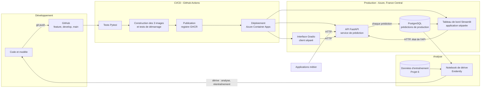

# Prêt à Dépenser : mise en production du modèle de scoring crédit

Projet 8 du parcours OpenClassrooms Data Scientist Machine Learning : *Confirmez vos compétences en MLOps (partie 2/2)*.

Ce dépôt met en production le modèle de scoring développé au Projet 6 : une API de prédiction testée, conteneurisée et déployée automatiquement sur Azure, chaque prédiction enregistrée dans une base PostgreSQL, une analyse de la dérive des données, un tableau de bord de suivi et une optimisation mesurée des temps de réponse.

## Applications en ligne

| Service | Adresse | Rôle |
|---|---|---|
| API de scoring | https://credit-scoring-api.blacksmoke-75226f42.francecentral.azurecontainerapps.io/docs | Service de prédiction autonome, utilisable par tout client (documentation Swagger) |
| Interface de test | https://credit-scoring-ui.blacksmoke-75226f42.francecentral.azurecontainerapps.io | Formulaire Gradio, client de l'API |
| Tableau de bord | https://credit-scoring-dashboard.blacksmoke-75226f42.francecentral.azurecontainerapps.io | Suivi de production : activité, scores, temps de réponse, dérive |
| Pipeline CI/CD | https://github.com/ouse4444/OC_DS_P8/actions | Tests, construction, publication et déploiement |

Les applications se mettent en veille quand elles ne sont pas utilisées : le premier appel peut prendre jusqu'à une minute.

## Contexte

Le département Crédit Express de Prêt à Dépenser souhaite évaluer les nouvelles demandes de crédit en quasi temps réel. Les attentes sont les suivantes :

- une **API** qui reçoit les données d'un client et renvoie une probabilité de défaut et une décision ;
- une **conteneurisation** et un **pipeline CI/CD** qui teste, construit et déploie automatiquement ;
- un **suivi des données de production** : distribution des scores, temps de réponse, erreurs et dérive des données ;
- une **analyse et une optimisation** des performances, la latence étant le critère principal.

## Architecture



**Principe d'architecture : l'API est un service autonome.** L'interface de test et le tableau de bord sont des applications séparées, chacune dans son conteneur, qui appellent l'API par HTTP. Si l'une d'elles tombe en panne, l'API continue de répondre à ses autres clients ; l'API reste légère, sans les dépendances des interfaces.

**Lecture du schéma.**

1. Chaque modification est développée sur une branche `feature/*`, fusionnée dans `develop`, puis dans `main`.
2. Chaque push déclenche GitHub Actions : tests, construction des trois images et tests de démarrage.
3. Sur `main` seulement, les images sont publiées puis déployées sur Azure, et chaque service est vérifié en ligne.
4. En production, chaque appel à l'API est enregistré dans PostgreSQL : entrées, score, décision, temps de traitement et erreurs.
5. Ces données alimentent le tableau de bord de suivi et l'analyse de dérive, qui les compare aux données d'entraînement.

## Le modèle

| Élément | Valeur |
|---|---|
| Origine | Projet 6, registre MLflow `credit_scoring_lightgbm_fbeta`, version 1 |
| Type | Pipeline scikit-learn : construction de variables, imputation et encodage, puis LightGBM |
| Variables en entrée | 199 (données client et agrégats des tables secondaires), plus 7 variables construites par le modèle |
| Métrique d'optimisation | F-bêta avec bêta = √10 (un défaut non détecté coûte environ 10 fois plus qu'un bon client refusé) |
| Seuil de décision | 0,36 |
| Résultats sur le jeu de test | AUC 0,7855, rappel 0,852, précision 0,138 |

Le modèle exporté reproduit à l'identique la matrice de confusion validée au Projet 6 (`notebooks/01_reprise_et_verification_modele.ipynb`). L'API lit directement le fichier `model/model.pkl` exporté par MLflow (format cloudpickle), sans charger MLflow : voir la section Optimisation.

## Structure du dépôt

```
OC_DS_P8/
├── .github/workflows/ci-cd.yml   pipeline CI/CD (6 jobs)
├── api/                          API FastAPI : routes, validation, modèle, journalisation
├── ui/                           interface Gradio : client de l'API, image séparée
├── dashboard/                    tableau de bord Streamlit : suivi de production, image séparée
├── model/                        modèle exporté depuis le registre MLflow du Projet 6
├── tests/                        tests automatisés (Pytest)
├── notebooks/                    vérification du modèle (01), analyse de dérive (02)
├── monitoring/reports/           rapports Evidently, tableaux de dérive, mesures de performance
├── scripts/                      reconstruction des données, simulation de trafic, mesures
├── docs/                         rapport d'optimisation
├── src/credit_scoring/           code source du Projet 6
├── data/                         données locales, jamais versionnées
├── Dockerfile                    image de l'API
├── requirements.txt              dépendances de l'API (versions figées)
├── requirements-dev.txt          dépendances de test (API, interface, tableau de bord)
└── monitoring/requirements.txt   dépendances d'analyse (MLflow, Evidently, Streamlit)
```

## Installation

Prérequis : Python 3.12 et [uv](https://docs.astral.sh/uv/).

```bash
git clone https://github.com/ouse4444/OC_DS_P8.git
cd OC_DS_P8
uv venv --python 3.12
source .venv/bin/activate
uv pip install -r requirements-dev.txt          # API, interface, tableau de bord et tests
uv pip install -r monitoring/requirements.txt   # notebooks et scripts d'analyse
```

Les bibliothèques du modèle sont figées sur les versions de son environnement d'export (scikit-learn 1.8.0, LightGBM 4.6.0, pandas 2.3.3, NumPy 2.4.6, SciPy 1.17.1, cloudpickle 3.1.2), pour un rechargement sans écart. Les outils sont lancés avec `python -m` (par exemple `python -m pytest`) pour être certain d'utiliser le Python de l'environnement du projet.

Les données ne sont pas versionnées (données clients). Elles se reconstruisent à partir de l'archive Kaggle *Home Credit Default Risk* :

```bash
python scripts/build_reference_data.py --zip-path chemin/vers/home-credit-default-risk.zip
```

Résultat attendu : 307 511 clients, 201 colonnes, taux de défaut de 8,07 %.

## L'API

```bash
python -m uvicorn api.main:app --reload    # puis http://127.0.0.1:8000/docs
```

| Route | Rôle |
|---|---|
| `GET /` | Message d'accueil |
| `GET /health` | État de l'API, du modèle et du stockage des prédictions |
| `GET /features` | Liste des 199 variables acceptées |
| `POST /predict` | Probabilité de défaut, décision (seuil 0,36), identifiant de requête et temps d'inférence |

- **Chargement unique** du modèle au démarrage de l'API.
- **Validation** : cinq champs obligatoires (type de contrat, genre, revenu, montant du crédit, âge), des champs bornés (revenu positif, âge entre 18 et 100 ans, scores entre 0 et 1), puis un contrôle du nom et du type des autres variables. Les variables non transmises sont imputées par le pipeline, comme à l'entraînement.
- **Codes de réponse** : 200 (succès), 422 (donnée invalide, message explicite), 503 (modèle indisponible), 500 (erreur imprévue, message générique sans détail interne).
- **Journalisation** : chaque appel, réussi ou non, est écrit en JSON dans les journaux et, si `DATABASE_URL` est définie, dans la table PostgreSQL `predictions`. L'écriture en base se fait après l'envoi de la réponse et ne fait jamais échouer une prédiction.

Interface de test, dans un second terminal (l'API doit tourner) :

```bash
API_URL=http://127.0.0.1:8000 python -m ui.app    # puis http://127.0.0.1:7860
```

## Tests

```bash
python -m pytest --cov=api --cov=ui --cov=dashboard --cov-report=term-missing
```

71 tests, couverture de 98 % (100 % pour l'API et l'interface). Ils couvrent les routes, 10 types d'entrées invalides, la concordance exacte avec le modèle, les pannes (modèle absent, erreur imprévue, base injoignable), la journalisation en base, l'interface et le tableau de bord, y compris lorsque l'API est injoignable. Les tests n'utilisent aucune donnée client : une base SQLite temporaire remplace PostgreSQL.

## Conteneurisation

Trois images, une par service, chacune avec ses propres dépendances :

| Image | Contexte | Contenu |
|---|---|---|
| API | `.` (`Dockerfile`) | Code de l'API et modèle, sans MLflow ni interfaces (744 Mo) |
| Interface | `ui/` | Gradio et le client HTTP |
| Tableau de bord | `dashboard/` | Streamlit, le client PostgreSQL et le profil agrégé de la référence |

Bonnes pratiques appliquées : image de base `python:3.12-slim`, dépendances installées avant le code (cache), utilisateur non root, vérification de santé, fichier `.dockerignore` (aucune donnée ni aucun secret dans les images).

```bash
docker build -t credit-scoring-api .
docker run -p 8000:8000 credit-scoring-api
```

## Pipeline CI/CD (GitHub Actions)

Déclenché à chaque push et pull request sur `develop` et `main` :

| Job | Rôle | Branches |
|---|---|---|
| 1. Tests and coverage | Pytest, couverture minimale de 90 % | toutes |
| 2. Build API image | Construction, taille de l'image, test de démarrage (modèle chargé) | toutes |
| 3. Build UI image | Construction, test de démarrage avec une API injoignable | toutes |
| 4. Build dashboard image | Construction, test de démarrage sans base ni API | toutes |
| 5. Publish images | Publication des trois images sur GHCR, étiquetées par commit | `main` |
| 6. Deploy | Mise à jour des trois applications Azure, puis vérification en ligne | `main` |

Les jobs 2, 3 et 4 s'exécutent en parallèle. Chaque image est étiquetée par l'identifiant du commit : chaque déploiement crée une révision traçable, à laquelle on peut revenir. Aucun secret n'est écrit dans le code : le registre utilise un jeton temporaire fourni par GitHub, et Azure un compte de service aux droits limités au groupe de ressources du projet, stocké dans un secret chiffré (`AZURE_CREDENTIALS`).

## Déploiement sur Azure

| Ressource | Nom | Rôle |
|---|---|---|
| Groupe de ressources | `rg-credit-scoring` | Regroupe toutes les ressources du projet |
| Environnement Container Apps | `env-credit-scoring` (France Central) | Hébergement des trois conteneurs, journaux Log Analytics |
| Applications | `credit-scoring-api`, `credit-scoring-ui`, `credit-scoring-dashboard` | Les trois services, en HTTPS, de 0 à 1 copie (mise en veille) |
| Base de données | Azure Database for PostgreSQL, base `monitoring` | Prédictions de production |

La région France Central garde les données dans l'Union européenne. L'adresse de la base, qui contient son mot de passe, est un secret de chaque application Container Apps. Le pare-feu de la base n'accepte que les services Azure et l'adresse du poste d'analyse. Une alerte budgétaire est en place ; la commande `az group delete --name rg-credit-scoring` supprime toutes les ressources en fin de projet.

## Stockage des données de production

Table `predictions` (créée automatiquement par l'API) : date, identifiant de requête, nom et version du modèle, code de réponse, probabilité, décision, seuil, temps d'inférence, temps total, entrées reçues (JSONB) et message d'erreur. L'identifiant de requête relie la réponse renvoyée au client et la ligne en base. Les rejets (422) et les erreurs (503, 500) sont enregistrés comme les succès : ils font partie du suivi.

## Simulation de trafic et analyse de dérive

```bash
python scripts/simulate_traffic.py --api-url https://credit-scoring-api.blacksmoke-75226f42.francecentral.azurecontainerapps.io
```

Le script envoie à l'API de vrais clients du jeu de test du Projet 6 : un lot normal (500), un lot modifié selon un scénario de changement de population (300 : clients plus jeunes, revenus plus faibles, montants plus élevés, scores externes plus faibles) et des requêtes invalides.

Le notebook `notebooks/02_analyse_derive.ipynb` compare la production à 20 000 clients d'entraînement avec Evidently, sur 206 variables :

| Lot | Variables en dérive | Importance du modèle portée par ces variables | Taux de refus |
|---|---|---|---|
| Normal | 11 sur 206 (fluctuations d'échantillonnage) | 1,5 % | 51,6 % (cohérent avec le Projet 6) |
| Modifié | 51 sur 206, dont toutes les variables du scénario | 57,6 % | 69,3 % |

Conclusion principale : la dérive ne provoque aucune erreur technique, mais elle modifie les décisions (davantage de bons clients refusés, précision en baisse). Le notebook propose des seuils d'alerte et une conduite à tenir. Rapports interactifs : `monitoring/reports/rapport_derive_lot_normal.html` et `rapport_derive_lot_modifie.html`.

## Tableau de bord de suivi (Streamlit)

Application séparée de l'API : elle lit la base PostgreSQL de production (`DATABASE_URL`) et interroge l'API par HTTP (`API_URL`) pour afficher son état. Elle présente le volume de requêtes, le taux d'erreur, la distribution des scores, le taux de refus, les temps de réponse et la dérive des 16 variables suivies (PSI calculé par rapport au profil agrégé `dashboard/reference_profile.json`, qui ne contient aucune donnée individuelle).

```bash
python -m streamlit run dashboard/app.py    # puis http://localhost:8501
```

## Optimisation des performances

Le profilage a montré que la mise en forme des données coûtait plus que le modèle lui-même. Deux optimisations ont été déployées, sans aucun écart de prédiction (AUC 0,7855 inchangée) :

| Mesure | Avant | Après |
|---|---|---|
| Requête complète, en local (médiane) | 8,9 ms | 3,9 ms (-56 %) |
| Traitement total en production sur Azure (médiane) | 90,1 ms | 30,4 ms (-66 %) |
| Taille de l'image Docker de l'API | 1,27 Go | 744 Mo (-41 %) |

Détail de la démarche et des mesures : [docs/rapport_optimisation.md](docs/rapport_optimisation.md). Mesure reproductible : `python scripts/benchmark_inference.py`.

## Sécurité et protection des données

- Aucune donnée client ni aucun secret dans le dépôt ou dans les images (`.gitignore`, `.dockerignore`, fichier `.env` local).
- Secrets chiffrés dans GitHub et dans Azure ; compte de service limité au groupe de ressources du projet.
- Conteneurs exécutés sans droits d'administrateur ; HTTPS fourni par Azure ; connexion chiffrée (TLS) à la base.
- Données hébergées dans l'Union européenne ; le tableau de bord n'utilise que des statistiques agrégées de la référence.

## Limites et améliorations possibles

- Les requêtes rejetées ne renvoient pas d'identifiant au client : renvoyer l'identifiant de requête dans toutes les réponses, y compris les erreurs.
- L'API n'a pas d'authentification : ajouter une clé d'API ou une authentification Microsoft Entra ID, et une limitation du nombre de requêtes.
- La performance réelle ne peut être mesurée qu'une fois les défauts connus : prévoir un suivi mensuel de l'AUC et du rappel, et un réentraînement validé avant tout déploiement.
- Fédération d'identité (OIDC) entre GitHub et Azure, pour supprimer le dernier secret stocké.

## Avancement

- [x] Phase 0 : dépôt, environnement, modèle exporté et vérifié, données de référence
- [x] Phase 1 : README et architecture
- [x] Phase 2 : API FastAPI, interface Gradio (client séparé)
- [x] Phase 3 : tests automatisés (Pytest)
- [x] Phase 4 : conteneurisation Docker (trois images)
- [x] Phase 5 : intégration continue (GitHub Actions)
- [x] Phase 6 : déploiement continu sur Azure Container Apps
- [x] Phase 7 : stockage des données de production (PostgreSQL sur Azure)
- [x] Phase 8 : simulation de trafic, analyse de la dérive (Evidently) et tableau de bord (Streamlit)
- [x] Phase 9 : analyse et optimisation des performances

---

Ousmane COUNDOUL, parcours Data Scientist Machine Learning, OpenClassrooms, novembre 2026.
